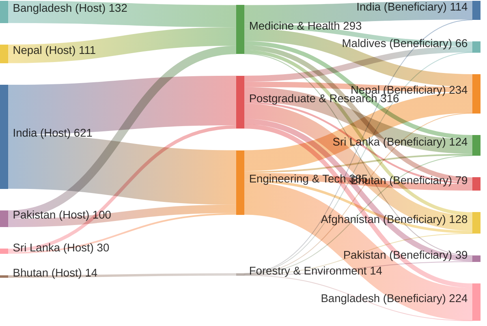

# South Asian Bilateral Relations & Benefits Index

An open-source interactive data dashboard and legal registry mapping cross-border relations, bilateral treaties, visa privileges, trade concessions, and student quotas across South Asian states.

🌐 **Live Demo:** [https://ajmals.github.io/saarc-benefits-index/](https://ajmals.github.io/saarc-benefits-index/)

---

## 1. About SAARC

### History
The **South Asian Association for Regional Cooperation (SAARC)** was founded on **December 8, 1985**, in Dhaka, Bangladesh, with seven founding member nations: **Bangladesh, Bhutan, India, Maldives, Nepal, Pakistan, and Sri Lanka**. **Afghanistan** joined as the eighth member state at the 14th SAARC Summit in New Delhi in 2007.

### Purpose
SAARC was established with the objective of accelerating economic growth, social progress, and cultural development in South Asia through collective self-reliance, mutual trust, and multilateral institutional cooperation. Key regional frameworks initiated under its umbrella include:
- The **Agreement on South Asian Free Trade Area (SAFTA)**
- The **South Asian University (SAU)** in New Delhi
- The **SAARC Visa Exemption Scheme (SVES)**
- Specialized regional centres addressing agriculture, energy, disaster mitigation, and tuberculosis.

### Regional Relationships & Bilateral Realities
While multilateral SAARC summits have frequently encountered diplomatic friction and political standstills, cross-border cooperation in South Asia operates on multiple tiers:
- **Broad Regional Accords:** Baseline concessions (such as SAFTA tariff phase-downs, SAU university subsidies, and monument ticket discounts) available to all member citizens.
- **Deep Bilateral Ties:** High-integration treaties between specific neighbours (such as the 1950 Indo-Nepal Treaty and 1949/2007 India-Bhutan Friendship Treaty) granting complete freedom of movement, right to reside, and national treatment.
- **Strategic Bilateral Concessions:** Targeted bilateral arrangements, such as Bangladesh’s port transit access for Nepal and Bhutan, India’s guaranteed export quotas for essential commodities to Maldives, and Bhutan’s Sustainable Development Fee (SDF) concessions.

This index maps both multilateral mechanisms and deep bilateral accords to provide an objective, data-backed view of how connected South Asian nations truly are in practice.

---

## 2. What the Dashboard Shows

The interactive dashboard transforms verified bilateral and multilateral accords into actionable metrics and visual comparisons:

### 1. Interactive Bilateral Relations Matrix
- An $8 \times 8$ matrix measuring the relational depth and concession intensity between each country pair.
- Scored on a verified 3-tier hierarchy:
  - **Level 1 (Regional Baseline - 1 pt):** Standard multilateral benefits across all members (e.g., SAARC Visa Exemption Scheme, basic transshipment priority).
  - **Level 2 (Preferential Concession - 2 pts):** Subsidized tariffs, academic quotas, or discounted entry fees (e.g., SAFTA tariff reductions, SAU student quotas, domestic monument ticket parity).
  - **Level 3 (Deep Bilateral Integration - 3 pts):** Open borders, unrestricted right to work and reside, guaranteed essential trade quotas, or exclusive transit corridors.

### 2. Multi-View Analytics
- **Heatmap View:** Instant color-coded intensity matrix across all 56 bilateral pairs.
- **Leaderboards & Rankings:** Ranking member states by bilateral integration score, provider volume, and received concessions.
- **Student Quota Architecture (Dual View):**
  - **Sankey Flow Diagram:** Directional pipeline mapping reserved academic quota seats from Host States $\rightarrow$ Disciplines (Medicine/MBBS, Engineering, Postgraduate/SAU, Forestry/Climate) $\rightarrow$ Recipient States.
  - **Quota Capacity Bar Chart:** Total annual seat capacities per country and discipline, with sub-toggles for provider vs. beneficiary grouping.
- **Reciprocity & Balance:** Analysis of mutual vs. asymmetrical benefits between trading and transit partners.
- **Sector Breakdown & Radar Profiles:** Multi-axis visualization comparing country scores across the 5 core domains:
  - 🚢 **Trade & Commerce** (SAFTA concessions, commodity quotas, port transit)
  - 🏛️ **Tourism & Culture** (World Heritage site discounts, tourism levy waivers)
  - 🎓 **Education & Higher Learning** (MBBS / engineering quotas, SAU subsidies, scholarships)
  - 🛂 **Mobility & Visa** (Free movement treaties, SVES clearances, visa waivers)
  - 💳 **Finance & Bilateral Liquidity** (Central bank currency swaps, development funding)

### 3. Student Quota Architecture & Sankey Pipeline

The dashboard features a dedicated cross-border academic mobility visualizer tracking **1,008 reserved annual seats** and scholarships across South Asia. The interactive Sankey diagram maps how educational capacity flows from host governments into specialized disciplines, and onwards to beneficiary states:

$$\text{Host Country (Provider)} \longrightarrow \text{Academic Discipline} \longrightarrow \text{Recipient Country (Beneficiary)}$$



#### Key Programs Tracked:
- 🩺 **Medicine & Health (293 seats/yr):** Bangladesh DGHS SAARC MBBS/BDS quotas (domestic fee parity of ~$100/yr vs $40k+ international fees), Nepal Medical Education Commission (MEC) foreign reserved quotas, and Pakistan PTAP medical allocations.
- ⚙️ **Engineering & Technology (385 seats/yr):** India ICCR bilateral engineering scholarships (Bangladesh, Nepal, Bhutan, Sri Lanka), Pakistan PTAP technical assistance seats, and Sri Lanka Presidential scholarships.
- 🎓 **Postgraduate & Research (316 seats/yr):** South Asian University (SAU, New Delhi) statutory country quota reservations (4%–10% per nation) and ICCR / Sri Lanka postgraduate research grants.
- 🌲 **Forestry & Climate Sciences (14 seats/yr):** South Asia Foundation (SAF) Madanjeet Singh Forestry Scholarships at the College of Natural Resources (CNR), Bhutan (2 fully-funded seats per member state).

### 4. Regional Visa Regimes & Mobility Visualizer

The dashboard includes a dedicated **Visa & Mobility Regimes Explorer** covering all 56 bilateral corridors across South Asia:

- **8×8 Bilateral Requirement Matrix:** Categorizes border friction across 5 verified tiers:
  - 🟢 **Freedom of Movement (4 corridors):** Unrestricted entry, residence, and employment rights with National ID/Voter card (e.g., India ↔ Nepal 1950 Treaty, India ↔ Bhutan 1949/2007 Treaty).
  - 🟢 **Visa-Free / Gratis Visa-on-Arrival (16 corridors):** 30–90 days fee-exempt entry on arrival (e.g., Maldives 30-day free VoA for all SAARC tourists, Nepal Rule 29 gratis 30-day SAARC VoA, India-Maldives 90-day visa-free agreement).
  - 🟡 **Concessionary ETA / Subsidized Entry (6 corridors):** Online Electronic Travel Authorization with discounted regional fees (e.g., Sri Lanka $20 SAARC ETA vs $50 non-regional fee).
  - 🟠 **Standard Consular Visa (26 corridors):** Traditional mission visa required prior to departure with standard documentary proofs.
  - 🔴 **Restricted / Prior Security Clearance (4 corridors):** City-specific endorsements, designated entry/exit checkpoints (Attari-Wagah or flights only), and mandatory Police Reporting (PRS) within 24 hours (e.g., India ↔ Pakistan 1974/2012 Visa Agreement, post-2021 Afghanistan emergency vetting).
- **Passport Freedom Explorer:** Allows selecting any of the 8 national passports to view a breakdown of allowable stay durations, entry fees, accepted ID documents, and special border conditions across the other 7 South Asian destinations.
- **SVES vs. Citizen Integration Paradox:** Visualizes the contrast between ordinary citizen border friction (46% of regional borders require consular visas or security clearances) and the multilateral **SAARC Visa Exemption Scheme (SVES)** granting 90-day multi-entry visa fee waivers across 24 designated dignitary, judicial, academic, media, and commerce categories.

### 5. Tourism & Culture / Heritage Access Visualizer

A specialized regional heritage access and tourist levy engine mapping:
- **Monument Entry Parity Explorer:** Side-by-side fee comparison across 24 UNESCO World Heritage cultural sites and ancient monuments (Taj Mahal, Red Fort, Sigiriya, Polonnaruwa, Bhaktapur, Lumbini, Lahore Fort, Taxila, Paharpur, Tiger's Nest). Demonstrates the regional discount (average 78.4% savings), including **100% domestic rate parity across all 143 Indian ASI ticketed monuments** (e.g., SAARC citizens pay ₹50 / $0.60 vs ₹1,100 / $13.25 for third-country tourists at the Taj Mahal—a 95.5% saving).
- **Bhutan Sustainable Development Fee (SDF) Simulator:** Interactive cost calculator quantifying the financial impact of Bhutan's *Tourism Levy Act of 2022 / 2023 Amendment*. Compares the statutory international tourist rate ($100/night) with the bilateral concessionary rate for Indian nationals (₹1,200/night ~$14.40), showing that an Indian family of four on a 7-day tour saves **~$2,400 in direct government tourism taxes alone**.
- **Cross-Border Heritage Circuits:** Tracks cumulative admission expenses and savings trajectories across multi-country itineraries, including the *Pan-South Asian Buddhist Pilgrimage Circuit* (Bodh Gaya $\rightarrow$ Nalanda $\rightarrow$ Sarnath $\rightarrow$ Kushinagar $\rightarrow$ Lumbini $\rightarrow$ Kathmandu), the *Grand UNESCO Cultural Flagships*, and the *Eastern Himalayas & Dragon Kingdom* route.
- **$8 \times 8$ Bilateral Heritage Reciprocity Grid:** Visualizes destination monument policies across 4 tiers: Full Domestic Parity (India ASI), Regional Concession 50–85% off (Sri Lanka CCF, Nepal Municipalities, Pakistan Antiquities, Bangladesh Archaeology), Bilateral Strategic Waiver (Bhutan SDF), and Standard Foreign Tariff.

### 6. Bilateral Deep Dive / Accord Inspector
- Click any cell or select any two nations to inspect verified legal instruments.
- View official treaty titles, legal basis (statutory acts, Gazette notifications, bilateral treaties), eligibility criteria, target audiences (commercial traders, students, diplomats, general public), and live source citations.

### 6. SAARC Regional Centres Directory
- Collapsible profiles of the 7 official regional institutions:
  - **SAC** (Dhaka, Bangladesh) — Agriculture & Livestock
  - **SEC** (Islamabad, Pakistan) — Renewable Energy & Regional Grid
  - **SCC** (Colombo, Sri Lanka) — Arts & Heritage Preservation
  - **STAC** (Bhaktapur, Nepal) — Public Health & Epidemiology
  - **SDMC** (Gandhinagar, India) — Disaster Risk Reduction & Early Warning
  - **SDF** (Thimphu, Bhutan) — Regional Development Finance
  - **SARCO** (Islamabad, Pakistan) — Commercial Dispute Arbitration
- Expandable cards showing focus areas, citizen eligibility, flagship programs, and official portals.

---

## 3. The Datasets

All datasets in this repository are open and backed by primary government and institutional sources (treaty texts, parliamentary acts, ministry circulars, and official SAARC publications).

| File | Format | Description | Key Fields |
| :--- | :--- | :--- | :--- |
| [`data/benefits_master.csv`](data/benefits_master.csv) | CSV | Master registry of verified bilateral and regional provisions. | `benefit_id`, `provider_iso`, `beneficiary_iso`, `category`, `title`, `description`, `benefit_level`, `reciprocity_type`, `target_audience`, `monetary_value_indicator`, `operational_status`, `legal_framework`, `source_name`, `source_url` |
| [`data/student_quotas.csv`](data/student_quotas.csv) | CSV | Master registry of reserved cross-border student quotas and scholarships. | `quota_id`, `provider_iso`, `beneficiary_iso`, `program_name`, `discipline`, `degree_level`, `seats_annual`, `concession_type`, `fee_benefit_description`, `legal_framework`, `source_name`, `source_url` |
| [`data/saarc_centres.csv`](data/saarc_centres.csv) | CSV | Directory of specialized SAARC institutional centres and funds. | `centre_code`, `name`, `host_country_iso`, `city`, `focus_area`, `eligibility`, `key_program`, `source_name`, `source_url` |
| [`data/bilateral_matrix.csv`](data/bilateral_matrix.csv) | CSV | Computed pair-wise intensity score matrix ($8 \times 8$). | `provider_iso`, `AFG`, `BGD`, `BTN`, `IND`, `MDV`, `NPL`, `PAK`, `LKA` |
| [`data/visa_matrix.json`](data/visa_matrix.json) | JSON | Complete 56-pair bilateral visa regimes and SVES statutory rules. | `metadata`, `tiers`, `sves`, `passport_power`, `matrix` |
| [`data/tourism_data.json`](data/tourism_data.json) | JSON | UNESCO monument admission schedules, Bhutan SDF levy comparison, circuits, and reciprocity. | `monuments`, `bhutan_sdf`, `heritage_circuits`, `reciprocity_matrix` |
| [`data/bilateral_matrix.json`](data/bilateral_matrix.json) | JSON | Complete compiled payload including total scores, category slices, and itemized records. | `countries`, `categories`, `scores`, `category_scores`, `records`, `metadata` |
| [`docs/data/`](docs/data/) | CSV / JSON | Production-ready mirrored data files consumed directly by the static web dashboard. | Mirrored from `data/` for zero-backend GitHub Pages hosting. |

---

## 4. Building & Running Locally

The dashboard is built entirely with vanilla web standards (HTML5, CSS3, ES6 JavaScript) and Plotly.js, requiring no Node.js or heavy frontend build toolchain.

### 1. Rebuild Dataset Matrices
To recompile the matrix whenever `benefits_master.csv` or `saarc_centres.csv` is updated:
```bash
python3 scripts/build_data.py
```
This automatically updates `data/bilateral_matrix.csv`, `data/bilateral_matrix.json`, and synchronizes them to `docs/data/`.

### 2. Launch Local Server
You can serve the web interface locally using Python's built-in HTTP server:
```bash
cd docs
python3 -m http.server 8000
```
Open [http://localhost:8000](http://localhost:8000) in your browser.

---

## 5. Contributing & Data Verifications

Accords and bilateral concessions change over time. If you notice an outdated tariff line, revised visa policy, or an omitted bilateral treaty:
1. Verify the provision against an official source (ministry circular, treaty database, or gazette notification).
2. Update [`data/benefits_master.csv`](data/benefits_master.csv) with the appropriate citations and `legal_framework`.
3. Run `python3 scripts/build_data.py` to regenerate the data payloads.
4. Submit a Pull Request.

---

## License

This project is licensed under the [MIT License](LICENSE). Datasets and public legal references are provided for civic, educational, and public research purposes.

